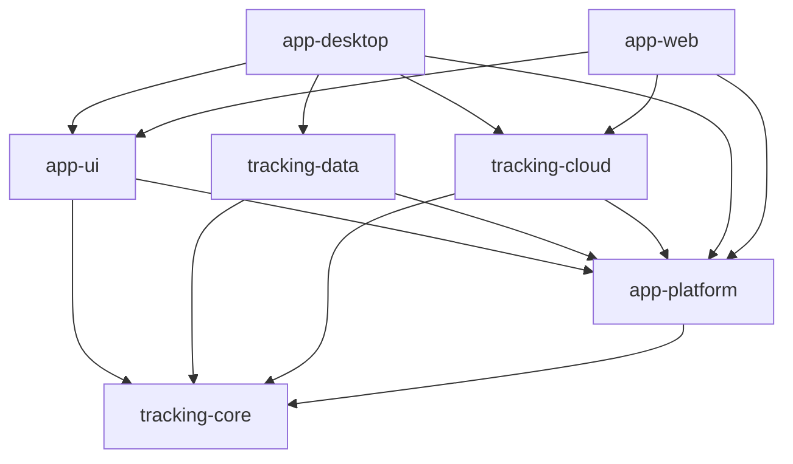

# Архитектура Tracking

## Модули

| Компонент | Ответственность |
| --- | --- |
| `tracking-core` | Сессии и их состояния, команды и правила таймера, календарные расчёты, отчёты, импорт и экспорт данных. |
| `app-platform` | Контракты для хранения, Supabase, файловых диалогов и уведомлений. |
| `tracking-data` | Локальное хранилище SQLite. |
| `tracking-cloud` | Асинхронный клиент Supabase Auth и Data API, объединение данных. |
| `app-ui` | Общие egui-экраны, стили и виджеты. Формы и навигация хранят состояние интерфейса. Действия, меняющие данные, отправляются в ядро. |
| `app-desktop` | Запуск нативного окна eframe, SQLite и интеграции с ОС. |
| `app-web` | Запуск eframe в canvas, асинхронные браузерные адаптеры для хранения, сети и файлов. |

Проверяемое направление зависимостей внутри workspace показано ниже. Стрелка указывает на зависимость.



Ядро собирается для native и WASM. Оно зависит от переносимых типов и библиотек. eframe, winit, SQLite, файловая система и браузерные API остаются в адаптерах и точках входа. `app-ui` зависит от egui и общих контрактов. Добавляйте интерфейсы платформенных сервисов по мере появления их реальных потребителей.

Десктопный адаптер сохраняет данные в SQLite. Браузерный адаптер
сохраняет состояние в одной транзакции IndexedDB. Оба используют
команды и модель данных ядра.

Платформенные адаптеры выполняют запросы к Supabase через `tracking-cloud`.
Конфигурация подключения и последняя синхронизированная копия сохраняются
вместе с локальным состоянием. Копия привязана к проекту и пользователю.
Токены Auth хранятся в памяти клиента. [Настройка Supabase](supabase.md)

## Команды и эффекты

Команды типизируют пользовательские действия вроде `StartTimer`, `PauseTimer`, `FinishSession` и `SavePeriod`. Ядро получает нужные входные данные, включая время, проверяет переход и возвращает результат и необходимые эффекты. UI, тесты и автоматизация пользуются этим же API. Набор команд может оставаться перечислением Rust.

Адаптер выполняет внешний эффект и возвращает результат в приложение. Отмечайте данные сохранёнными после подтверждения записи соответствующей ревизии. Позднее подтверждение старой операции не должно помечать более новые изменения сохранёнными. Храните отметки времени сессий в UTC и явно задавайте часовой пояс при построении отчёта. Восстанавливайте состояние таймера из сохранённых отметок после перезапуска или сна устройства.

Кнопки, хоткеи и автоматизация должны приводить к одному результату команды. Выбор вкладки, фокус ввода и размеры панелей живут в `app-ui`. Не переносите их в бизнес-модель.

## Управление и проверка

Начните с командного test harness с управляемыми часами и тестовыми данными. Нативный инструмент проверки UI использует тот же набор команд и может выдавать состояние и снимок после завершения отрисовки. Первому набору операций достаточно запуска сценария, чтения состояния и получения PNG. Для процесса тестирования подходит JSONL через stdin/stdout с идентификатором запроса. Действия сценария идут через ядро, а проверка кликов и клавиш идёт через события egui. Браузерный smoke-тест запускает ту же форму приложения в canvas и проверяет результат после перезагрузки страницы.

Минимальный сценарий для будущего интерфейса управления может выглядеть так.

```jsonl
{"id":1,"method":"app.execute","params":{"command":"start_timer","kind":"work"}}
{"id":2,"method":"app.inspect","params":{}}
{"id":3,"method":"ui.screenshot","params":{"name":"timer-running.png"}}
```

Ответ связывается с запросом по `id` и содержит результат или ошибку. Снимок возвращает путь в каталоге результатов. Запускайте инструмент с отдельным профилем, фиксированным временем, тестовыми данными и отдельным каталогом результатов. Этот интерфейс предназначен для разработки.

## Дальнейшее развитие

- Добавить сценарии управления и снимков для критичных потоков.
- Реализовать Android-клиент на `tracking-core`.

## Ориентиры

- DesignCraft показывает, как один интерфейс команд обслуживает UI, headless-режим и управление работающим приложением. [Архитектура](https://github.com/storytold/designcraft/blob/4000591c6681d01386b9576f9a050b8460e6f2e3/docs/architecture.md) · [Протокол](https://github.com/storytold/designcraft/blob/4000591c6681d01386b9576f9a050b8460e6f2e3/docs/control-protocol.md)
- Craft Anything показывает регистрацию инструмента для нескольких точек входа. [Extending Craft Anything](https://github.com/storytold/craft-anything/blob/827be601e781daea91ce2013fa0f64d658abd028/docs/extending.md)
- В Tracking эти подходы реализуются в собственных модулях без зависимостей от приложений или библиотек Craft.
